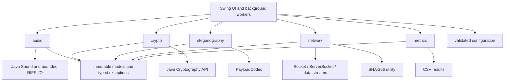
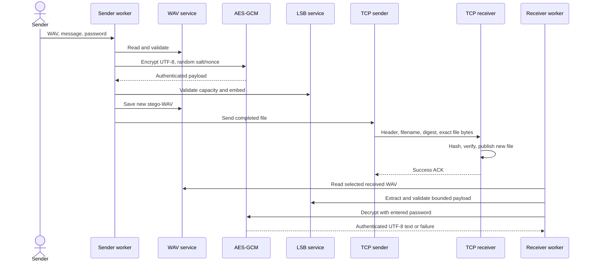

# Architecture and module contracts

Status: finalized Phase 1 design; only the entry point and configuration are implemented. Use one Maven module, organized into packages. This avoids inter-module build complexity for a college mini-project.

Runtime dependency: JDK 21 only. Test dependency: JUnit Jupiter 5.11.4. Maven plugins are build tools, not shipped application libraries. GUI orchestration calls encryption then embedding; LSB code does not derive keys or open sockets. Network code transfers arbitrary bounded bytes and does not interpret or decrypt audio.

## Public interfaces to implement

These signatures are design contracts, not existing Java implementations. Each phase will create the listed types, imports and method bodies. Concrete services suffice; no duplicate interface/implementation hierarchy is needed.

| Owner | Planned public operations and contract |
|---|---|
| `WavFileService` | `PcmAudio read(Path)`; `void writeNew(Path, PcmAudio)`. Throw `IOException` or `UnsupportedAudioException`. Validate RIFF bounds; refuse existing destination. |
| `PcmAudio` | Immutable sample format, PCM bytes and ordered RIFF chunks; defensive copies. Frame count derived from aligned data length. |
| `AudioPlayer` | `void play(PcmAudio)`; `void stop()`; `close()`. Manage `Clip`; surface device failures. |
| `AudioRecorder` (optional) | `start(AudioFormat)`; `PcmAudio stop()`; `close()`. Bounded duration/bytes; close `TargetDataLine` on failure. |
| `PasswordKeyDeriver` | `SecretKey derive(char[], byte[], int)` with validated salt/work factor; clear `PBEKeySpec` after use. |
| `AesGcmService` | `EncryptedPayload encrypt(byte[], char[], int)`; `byte[] decrypt(EncryptedPayload, char[])`. Generate secure salt/nonce; use canonical header as AAD; map bad tags to `AuthenticationException`. |
| `EncryptedPayload` | Immutable salt, nonce, iterations, ciphertext including tag, version; fixed algorithm identifiers for v1. No password or key field. |
| `PayloadCodec` | `byte[] encode(EncryptedPayload)`; `EncryptedPayload decode(byte[])`. Exact length and version checks; shared canonical AAD encoder. |
| `LsbSteganography` | `long capacityBytes(PcmAudio)`; `EmbeddingResult embed(PcmAudio, EncryptedPayload)`; `EncryptedPayload extract(PcmAudio)`. Validate full capacity before copying/modifying. |
| `EmbeddingResult` | Stego audio, payload bytes, usable message capacity and measured embedding duration. |
| `TcpFileSender` | `TransferReceipt send(Path, String, int, LongConsumer)` using settings; success only after receiver acknowledgement. Progress reports transferred bytes. |
| `TcpFileReceiver` | `start(InetAddress, int, Path, Consumer<TransferReceipt>, LongConsumer)`; `int localPort()`; `stop()`; `close()`. `start` binds before returning and runs accept in a worker; supports ephemeral port 0 for tests. |
| `TransferReceipt` | Destination (receiver) or source (sender), verified byte length, SHA-256 digest, elapsed nanoseconds. No success receipt for failed acknowledgement. |
| `AudioMetrics` | `double snrDb(PcmAudio, PcmAudio)`; capacity/utilization helpers. Reject mismatched formats or lengths. |
| `CsvResultWriter` | `writeNew(Path, List<ExperimentResult>)` with locale-independent numbers and escaped CSV fields. |
| `ExperimentRunner` | Deterministic carrier/message scenarios; secure encryption remains randomized; write environment and run metadata. |

Packages `exception`, `model`, `config`, and `util` support the named services. Use checked domain exceptions for recoverable input/authentication/transfer failures; never silently swallow exceptions. Do not claim corruption versus incorrect password can be distinguished after a GCM tag failure.

## End-to-end sequence

## Ownership and concurrency

Swing components change only on the event dispatch thread. File I/O, PBKDF2, embedding, extraction, hashing, networking and experiments run in `SwingWorker` or a receiver executor. Snapshot user inputs before work; disable conflicting controls; marshal progress and results back to Swing. Clear password character arrays in `finally`; Java cannot guarantee erasure of all provider or text-widget copies. Never log plaintext, passwords or keys.

Closing the receiver closes the listening socket and active socket to unblock accept/read; cancellation must close blocking resources, not only interrupt a thread. Process one transfer at a time initially. Bind localhost by default; expose an explicit LAN bind setting. Provide local file selection in the receiver, so offline decoding also works.
